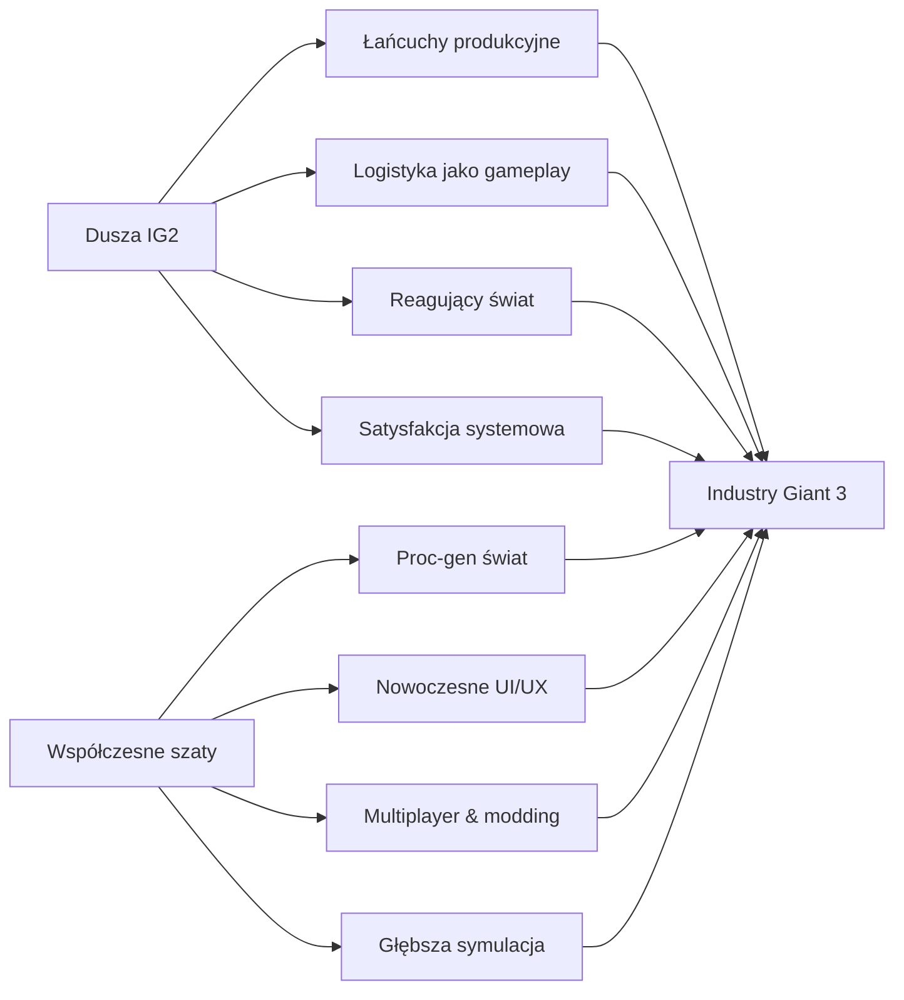
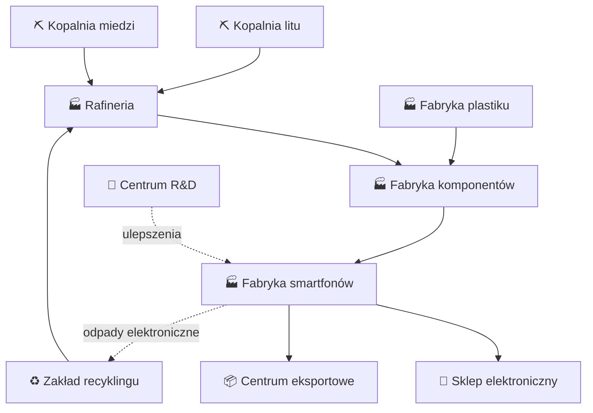
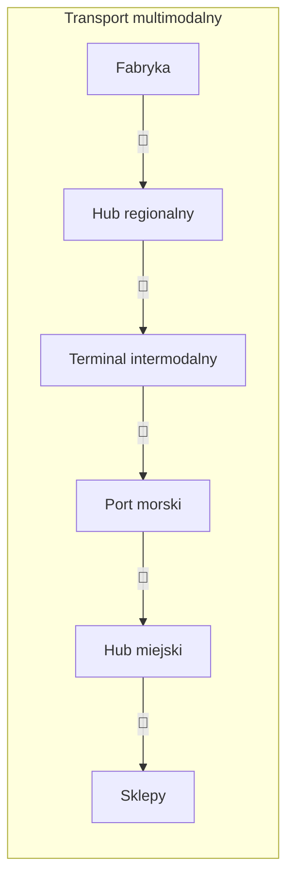
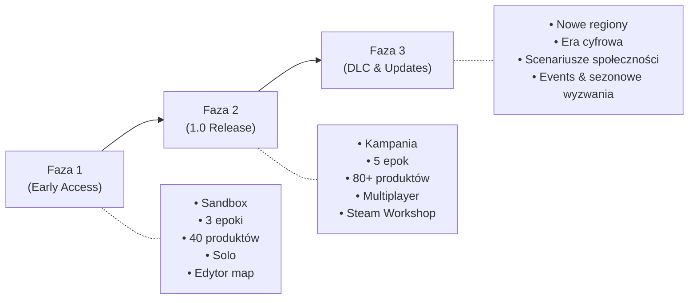

# Industry Giant 2 — Analiza & Plan Kontynuacji

---

## Część I: Dlaczego Industry Giant 2 zdobyło serca graczy

### 🏭 1. Łańcuchy produkcyjne — serce gry

Industry Giant 2 oferowało coś, czego żadna inna gra tycoonowa nie robiła z taką głębią: **wieloetapowe łańcuchy produkcyjne od surowca do produktu końcowego**.

- Hodowałeś bydło → przetwarzałeś na mięso → transportowałeś do sklepów
- Wydobywałeś rudę żelaza → przerabiałeś na stal → produkowałeś samochody
- Uprawiałeś bawełnę → tkałeś tkaniny → szywałeś ubrania

Każdy etap wymagał osobnej fabryki, osobnego transportu, osobnego planowania. To dawało **poczucie budowania prawdziwego imperium przemysłowego**, a nie tylko stawiania budynków. Gracz czuł się jak industrialista XIX/XX wieku.

> [!TIP]
> **Kluczowy insight**: Satysfakcja nie wynikała z samego zysku, lecz z momentu, gdy cały łańcuch „zaczynał oddychać" — surowce płynęły, fabryki pracowały, ciężarówki kursowały, a sklepy sprzedawały. To była **satysfakcja systemowa**.

### 🚛 2. Logistyka jako gameplay

Transport nie był dodatkiem — był **rdzeniem rozgrywki**:

- Wybór środka transportu (ciężarówki, pociągi, statki)
- Optymalizacja tras i ładunków
- Zarządzanie flotą i pojemnością
- Balansowanie kosztów transportu vs. szybkości dostaw

Gracz musiał myśleć o tym, **gdzie postawić fabrykę** względem źródeł surowców i rynków zbytu. Geografia miała znaczenie. To tworzyło naturalną warstwę strategiczną bez potrzeby sztucznych mechanik.

### 📊 3. Czytelna ekonomia z głębią pod spodem

Na powierzchni gra była prosta: kup, produkuj, sprzedaj. Ale pod spodem kryła się symulacja:

- **Popyt zależny od populacji** — miasta rosły i zmieniały potrzeby
- **Ceny rynkowe** reagowały na podaż i popyt
- **Sezonowość** pewnych produktów
- **Konkurencja AI** — rywale budowali swoje imperia

Gracz nie musiał rozumieć wszystkiego od razu, ale z każdą partią odkrywał nowe warstwy. To klasyczna formuła **"easy to learn, hard to master"**.

### 🗺️ 4. Sandbox z poczuciem celu

Gra oferowała zarówno **kampanię** (scenariusze z konkretnymi celami), jak i **tryb wolny** (sandbox). Kluczowe było to, że nawet w sandboxie gracz miał naturalną motywację:

- Kolejne produkty do odblokowania (drzewo technologiczne przez epoki)
- Miasta do zaopatrzenia
- Rywale do pokonania
- Nowe tereny do eksploracji

Nie potrzebowałeś quest-loga — **sam system generował cele**.

### 🏙️ 5. Żywy, reagujący świat

- Miasta rosły, gdy były dobrze zaopatrywane
- Populacja napędzała popyt
- Infrastruktura (drogi, tory) zmieniała krajobraz
- Widziałeś, jak Twoje imperium fizycznie rozrasta się na mapie

To dawało **namacalny feedback** — Twoje decyzje miały widoczne konsekwencje.

### ⏳ 6. Tempo i flow

Gra miała znakomite tempo:

- Początek: proste łańcuchy (farma → sklep), szybka gratyfikacja
- Środek: rosnąca złożoność, potrzeba optymalizacji
- Późna gra: zarządzanie rozległym imperium, makro-decyzje

Nie było „ścian" ani momentów, w których nie wiadomo co robić. Zawsze był następny produkt, następne miasto, następny łańcuch do zbudowania.

### 🎨 7. Czytelność wizualna

Mimo prostej grafiki (2002 rok), gra była **czytelna**:

- Widać było co produkuje dana fabryka
- Trasy transportowe były jasne
- Sklepy pokazywały braki towaru
- Mapa była intuicyjna

---

## Część II: Plan kontynuacji — „Industry Giant" na miarę 2026 roku

### 🎯 Filozofia designu

> **„Zachowaj duszę, wymień ciało"**

Celem nie jest zrobienie „takiej samej gry ale ładniejszej". Celem jest uchwycenie tego, co sprawiało, że IG2 było wciągające, i osadzenie tego w nowoczesnych standardach — zarówno technologicznych, jak i designerskich.

---

### 📐 Filar 1: Łańcuchy produkcyjne 2.0

#### Co zachować:
- Wieloetapowa produkcja od surowca do produktu
- Fizyczne budynki na mapie (farmy, kopalnie, fabryki, sklepy)
- Konieczność transportu między etapami

#### Co dodać:

| Mechanika | Opis |
|-----------|------|
| **Jakość surowców** | Nie każda ruda jest taka sama — lokalizacja wpływa na jakość, a jakość na cenę produktu końcowego |
| **Produkty uboczne & odpady** | Produkcja stali generuje żużel, produkcja żywności — odpady organiczne. Można je utylizować (koszt) lub przetwarzać (zysk) |
| **R&D i ulepszenia** | Laboratorium badawcze pozwala ulepszać receptury, zwiększać wydajność, odkrywać nowe produkty |
| **Elastyczne receptury** | Czekoladę można robić z tańszego kakao (niższa jakość) lub premium (wyższa cena). Gracz wybiera strategię |
| **Epoki technologiczne** | Od rewolucji przemysłowej po erę cyfrową — nowe produkty, nowe technologie, nowe wyzwania (np. w erze cyfrowej: produkcja elektroniki, centra danych) |

#### Przykładowy łańcuch (era współczesna):

---

### 🚂 Filar 2: Logistyka — od ciężarówek po drony

#### Co zachować:
- Transport jako kluczowy element gameplay'u
- Fizyczne trasy na mapie
- Różne środki transportu

#### Co dodać:

- **System hubów logistycznych** — magazyny centralne, z których towary dystrybuowane są do wielu odbiorców (zamiast point-to-point jak w oryginale)
- **Automatyzacja** — w późniejszych epokach: zautomatyzowane magazyny, drony dostawcze, autonomiczne ciężarówki
- **Wąskie gardła** — wizualizacja przepustowości tras; korki na drogach, zatłoczenie torów. Gracz musi to rozwiązywać
- **Kontenery i intermodalność** — towar w kontenerze płynnie przechodzi z ciężarówki na pociąg na statek
- **System priorytetów** — gracz ustala, które dostawy mają pierwszeństwo w razie niedoborów

---

### 🌍 Filar 3: Żywy, proceduralny świat

#### Co zachować:
- Miasta reagujące na zaopatrzenie
- Znaczenie geografii
- Poczucie rozrastającego się imperium

#### Co dodać:

- **Proceduralna generacja map** — każda partia na unikalnej mapie z różnymi zasobami, klimatami, rzeźbą terenu
- **Dynamiczna demografia** — miasta nie tylko rosną/maleją; mają strukturę populacji (bogaci/biedni), preferencje, trendy
- **Globalna mapa + regiony** — gra na skali kontynentalnej lub globalnej, z możliwością eksportu/importu między regionami
- **Pogoda i katastrofy** — susze wpływają na rolnictwo, sztormy na transport morski, trzęsienia ziemi niszczą infrastrukturę
- **Regulacje i polityka** — rządy wprowadzają normy emisji, podatki, subsydia. Gracz musi się adaptować

---

### 🖥️ Filar 4: Nowoczesne UI/UX

To tutaj IG2 najbardziej się zestarzało. Współczesna kontynuacja musi mieć:

#### Dashboard CEO
- Centralny panel z **KPI**: przychody, koszty, zysk netto, przepływy pieniężne
- **Widok łańcuchów** — interaktywny diagram wszystkich Twoich łańcuchów produkcyjnych (jak powyższe schematy, ale żywe, z przepływem towarów w real-time)
- **Heatmapy** — zapotrzebowanie miast, nasycenie rynku, rentowność tras

#### Inteligentne budowanie
- **Blueprinty** — zapisuj i powielaj sprawdzone konfiguracje (np. „farma + młyn + piekarnia + sklep")
- **Podpowiedzi kontekstowe** — „Ten region ma niedobór żywności" / „Ta fabryka pracuje na 30% mocy"
- **Snap & auto-connect** — automatyczne tworzenie tras transportowych między kompatybilnymi budynkami

#### Czytelność na każdej skali
- **Zoom semantyczny** — blisko: widzisz detale budynków i animacje; daleko: widzisz ikony, przepływy, statystyki
- **Filtry warstw** — pokaż tylko: transport / produkcja / zaopatrzenie / rentowność
- **Minimapa z overlay'ami**

---

### 🌐 Filar 5: Multiplayer & społeczność

#### Tryby multiplayer:
| Tryb | Opis |
|------|------|
| **Kooperacja** | Gracze dzielą mapę, mogą handlować surowcami i produktami, specjalizować się |
| **Rywalizacja** | Klasyczna walka o rynki — kto pierwszy zaspokoí popyt miasta, ten zgarnia zysk |
| **Scenariusze kooperacyjne** | „Odbudujcie gospodarkę po katastrofie" — wspólne cele, podział pracy |

#### Modding & Steam Workshop:
- **Edytor produktów** — definiuj własne towary i łańcuchy
- **Edytor scenariuszy** — twórz kampanie z własnymi celami
- **Edytor map** — rzeźba terenu, rozmieszczenie zasobów i miast
- **Lua/modding API** — głębokie modyfikacje mechanik

---

### 🌱 Filar 6: Nowe warstwy gameplay'u (których nie było w IG2)

#### 🏦 Finanse korporacyjne
- **Kredyty i obligacje** — finansowanie ekspansji z różnymi warunkami
- **Giełda** — akcje Twojej firmy i konkurencji; możliwość wrogich przejęć
- **Fuzje i akwizycje** — kupuj fabryki rywali zamiast budować od zera

#### 👷 Zasoby ludzkie
- **Rynek pracy** — fabryki potrzebują pracowników; w małych miastach trudniej o kadrę
- **Szkolenia i specjalizacje** — wykwalifikowani pracownicy = wyższa wydajność
- **Automatyzacja vs. zatrudnienie** — roboty są droższe na starcie, ale nie strajkują

#### ♻️ Ekologia i zrównoważony rozwój
- **Emisje i zanieczyszczenia** — fabryki emitują CO₂, zanieczyszczają wodę
- **Opinia publiczna** — zanieczyszczanie obniża Twój rating, miasta mogą odmawiać pozwoleń
- **Zielone technologie** — panele słoneczne, elektrownie wiatrowe, recykling. Droższe, ale dają bonusy reputacyjne i regulacyjne
- **Ślad węglowy produktu** — konsumenci premium wolą „zielone" produkty

> [!IMPORTANT]
> Ekologia nie powinna być „karą" ani moralizowaniem. Powinna być **kolejną warstwą optymalizacji** — gracz sam odkrywa, że zrównoważony rozwój bywa bardziej opłacalny w długim terminie.

#### 📱 Era cyfrowa (późna gra)
- **E-commerce** — sklepy internetowe jako alternatywa dla fizycznych
- **Centra danych** — nowy typ infrastruktury dla ery cyfrowej
- **Logistyka ostatniej mili** — paczkomaty, drony, kurierzy
- **Big Data** — analityka pozwala lepiej prognozować popyt

---

### 🎮 Filar 7: Oprawa i atmosfera

#### Grafika
- **Silnik 3D** z detailami na poziomie Cities: Skylines 2 / Satisfactory
- **Animacje produkcji** — widać jak maszyny pracują, jak towary schodzą z taśmy
- **Cykl dnia i nocy** + pory roku wpływające na wizualia i gameplay
- **Tilt-shift** opcjonalny efekt kamery dla klasycznego „tycoonowego" feelu

#### Dźwięk
- **Ambientowa ścieżka dźwiękowa** — spokojna, nienachalna, budująca atmosferę skupienia (jak w IG2!)
- **Dźwięki kontekstowe** — zbliż kamerę do fabryki i usłyszysz maszyny; do farmy — zwierzęta; do miasta — gwar
- **Satysfakcjonujące SFX** — kliknięcia, potwierdzenia, dźwięki sukcesu. Pozornie drobiazg, ale kluczowy dla „juice" gry

#### Tutorial i onboarding
- **Kampania jako tutorial** — pierwsze scenariusze uczą mechanik krok po kroku
- **System „mentor"** — NPC-doradca podpowiada (opcjonalnie), gdy gracz ma problemy
- **Tooltips i encyklopedia** — każdy element gry ma opis i kontekst

---

### 📅 Roadmap rozwoju

---

### 🧬 Podsumowanie DNA gry

| Cecha IG2 | Jak to zachować | Jak to ulepszyć |
|-----------|----------------|-----------------|
| Łańcuchy produkcyjne | Wieloetapowa produkcja to rdzeń | Jakość, receptury, R&D, produkty uboczne |
| Logistyka | Transport między budynkami | Huby, intermodalność, automatyzacja |
| Reagujący świat | Miasta rosną przy zaopatrzeniu | Demografia, polityka, opinia publiczna |
| Czytelność | Proste wizualia, jasne ikony | Zoom semantyczny, heatmapy, filtry |
| Flow/tempo | Zawsze jest co robić | Blueprinty, podpowiedzi, adaptacyjny tutorial |
| Sandbox freedom | Tryb wolny bez ograniczeń | Proc-gen mapy, modding, multiplayer |
| Satysfakcja systemowa | Patrzenie jak system działa | Animacje, dźwięki, dashboard real-time |

---

> [!NOTE]
> Najważniejsza zasada projektowa: **Gracz powinien czuć się jak budowniczy przemysłowego imperium, nie jak księgowy ani klikacz.** Każda mechanika powinna dawać wizualny, słyszalny i ekonomiczny feedback. Złożoność powinna wynikać z interakcji prostych systemów, nie z zapamiętywania reguł.
